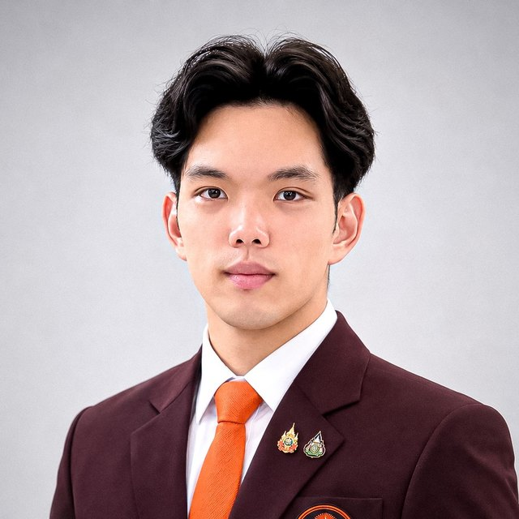

```{=html}
<style>#title-block-header{display:none}</style>
```

::: {.hero}
::: {.hero-portrait}
{fig-alt="Portrait of Thammarat Yawisit" fetchpriority="high" width="220" height="220"}
:::

::: {.hero-text}
```{=html}
<h1 class="hero-name">Thammarat Yawisit</h1>
```

::: {.designation}
, 
:::

::: {.affiliation}
 · 
:::

::: {.mission}
I work on the measurement chain of experimental physics: testing detector hardware, designing trigger and data-acquisition methods, and checking that the resulting signals can be trusted. My work so far has focused on optical modules and trigger systems for neutrino telescopes, and now includes the commissioning of an NMR quantum computer.
:::

::: {.hero-links}
[Download CV (PDF)](assets/cv/CV_Thammarat_Yawisit.pdf){.btn-tw .primary}
[Publications](publications/index.qmd){.btn-tw}
[Research](research/index.qmd){.btn-tw}
[ORCID](https://orcid.org/0009-0006-9298-8862){.btn-tw}
[Google Scholar](https://scholar.google.com/citations?user=w1ewAQ0AAAAJ){.btn-tw}
[GitHub](https://github.com/poundthammaratx){.btn-tw}
[Contact](cv/index.qmd#contact){.btn-tw}
:::
:::
:::

::: {.qa-grid}
::: {}
### Who

Engineer in the Academic Support Division, School of Engineering, KMITL (since October 2026). B.Eng. in Mechatronics and Automation Engineering, KMITL. Research experience at WIPAC (IceCube), KMITL and Chulabhorn Royal Academy. [More about me →](about/index.qmd)
:::

::: {}
### What problems

- How to test neutrino-telescope optical modules using cosmic-ray muons.
- How to keep triggers efficient when detector channels are temporarily dead.
- How reliable a signal is when part of the readout is lost.
- How to commission quantum hardware for research and teaching.
:::

::: {}
### What you can verify

- Conference contributions, preprints and technical reports with DOIs or arXiv identifiers.
- Open analysis code and an open-data system on GitHub.
- Talks at CHEP 2026, INST 2026 and IceCube collaboration meetings.

[Publications →](publications/index.qmd) · [Activities →](activities/index.qmd)
:::
:::

## Research interests

::: {.chips}
- Experimental astroparticle physics
- Neutrino and cosmic-ray detector instrumentation
- Scientific data acquisition and signal processing
- Measurement and control systems
- Optics, photonics and advanced electronics
- Quantum computing and quantum instrumentation
- Scientific software and computational methods
:::

## Selected research

:::{#featured-research}
:::

[All research projects →](research/index.qmd)

## Featured publications

:::{#featured-pubs}
:::

[Full publication list with filters and BibTeX →](publications/index.qmd)

## Engineering & software

:::{#featured-engineering}
:::

[Engineering portfolio →](engineering/index.qmd)

## Recent academic activities

:::{#recent-talks}
:::

[All talks, teaching and service →](activities/index.qmd)

## Contact {#contact}

::: {.contact-grid}
::: {}
### Email

[ (at) ]{.obf-email}
:::

::: {}
### Institution

<br><br>
:::

::: {}
### Profiles

[ORCID](https://orcid.org/0009-0006-9298-8862)<br>
[Google Scholar](https://scholar.google.com/citations?user=w1ewAQ0AAAAJ)<br>
[LinkedIn](https://www.linkedin.com/in/thammaratya)<br>
[GitHub](https://github.com/poundthammaratx)
:::
:::
